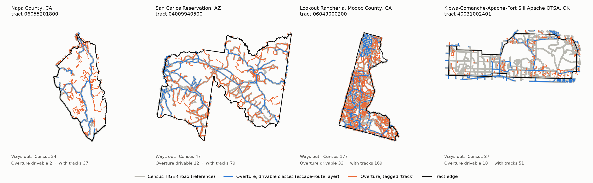
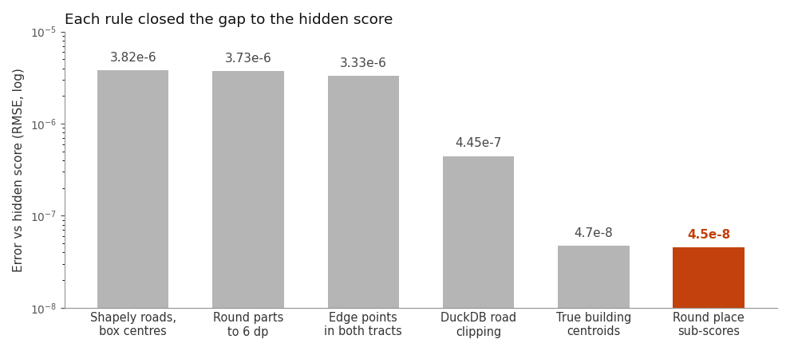
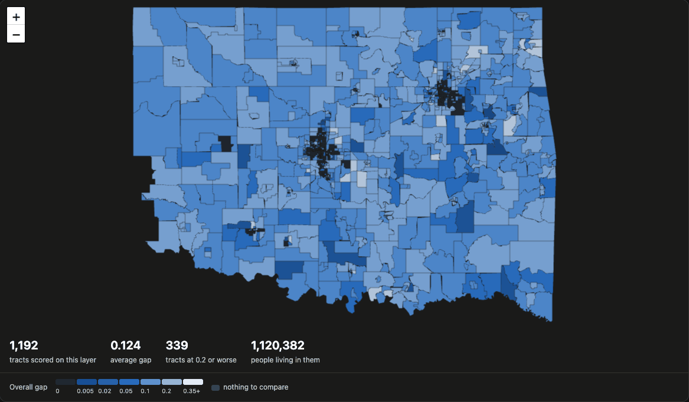

# road-coverage-audit



*Grey: Census TIGER roads. Blue: the escape-route layer. Orange: Overture roads tagged `track`. Three tracts have the roads but mislabelled; in Oklahoma they are simply missing.*

A rebuild of a hidden census-tract map-coverage score, and an audit showing that the "escape-route" road layer hides about a fifth of the roads out of rural tracts.

## The problem

A public challenge scored 9,379 US census tracts in four regions on how well open map data (Overture Maps) covers roads, buildings and essential places, compared with government reference data such as Census TIGER roads. The scoring formula was described in words but the code was hidden, so the first task was to rebuild it exactly, down to the sixth decimal. The second task was to find a bias in the map data that the score itself does not show.

## What I built and found

**An exact rebuild of the score.** Each rule was checked against the public leaderboard, taking the error from 3.8e-6 to **4.5e-8** (lower is better):



The last digits come down to floating-point details: many roads sit exactly on tract edges, so whether a piece counts inside or outside depends on the geometry engine and even the operating system. Running the road step on Linux instead of macOS changes exactly one tract.



*The overall score per tract in Eastern Oklahoma (lighter = more missing). The interactive map of all four regions can be rebuilt with `experiments/make_map.py`.*

**The bias: missing ways out.** I counted the roads that cross each tract's edge (its ways out) on Census TIGER roads and on the challenge's escape-route road layer. Per tract, on average:

| | Ways out hidden from the escape-route layer | After adding Overture `track` roads back |
|---|---:|---:|
| Rural tracts (1,712) | **19.4%** | 8.9% |
| Urban tracts (7,653) | 4.4% | 3.7% |
| Tribal tracts (858) | 14.5% | 9.8% |
| Non-tribal tracts | 6.4% | 4.1% |
| Highest wildfire hazard quarter | 12.2% | 6.1% |
| Lowest wildfire hazard quarter | 4.8% | 4.2% |

- 221 tracts, home to 635,069 people, show half or fewer of their real ways out. 143 are rural and 33 are tribal.
- In the highest-wildfire tracts (9.6 million people), 19,179 of 106,887 ways out are hidden.
- About half of the rural gap is roads Overture has but labels `track`, which the escape-route layer drops. The other half is roads missing from Overture entirely.
- The score cannot see this: its road part only compares named highways, and it is undefined for the 3,044 tracts (32%) with none.
- Social vulnerability shows no difference (7.3% vs 7.1%).

Full method, robustness checks and the two ideas that came back negative are in [WRITEUP.md](WRITEUP.md).

## Layout

```
src/            the score rebuild
  fetch.py            pull only the needed columns from the challenge bucket
  fetch_centroids.py  true centroids for buildings that cross a tract edge
  score.py            per-tract road, building and place gaps
  reference_duckdb.py full DuckDB rebuild, used as a cross-check
  roads_linux.py      road lengths on linux/arm64 (run in Docker)
  apply_linux_roads.py swap in the Linux road lengths
  make_submission.py  join regions and apply the rounding rules
experiments/    the bias audit: scripts, text results, per-tract CSVs
viz/            tract-map figure
docs/           README images
```

## Reproduce

Data is public:

- Challenge data package (Overture, Census TIGER, Microsoft buildings, HIFLD facilities, Census business counts, per region): `s3://us-west-2.opendata.source.coop/humane-intelligence/bias-bounty-mapping-equity-challenge` on [Source Cooperative](https://source.coop)
- [Overture Maps](https://overturemaps.org), [Census TIGER/Line](https://www.census.gov/geographies/mapping-files/time-series/geo/tiger-line-file.html)
- Challenge page: https://zindi.world/competitions/bias-bounty-mapping-equity-challenge (the scored tract list `SampleSubmission.csv` comes from here; save it as `data/SampleSubmission.csv`)
- Transit feeds for one negative test: URLs in `experiments/gtfs_sources.txt`

Needs [uv](https://docs.astral.sh/uv/) and about 3 GB of disk.

```
R="northern-ca eastern-ok maricopa-az south-central-tx"
uv run python src/fetch.py $R               # about 1.4 GB
uv run python src/fetch_centroids.py $R     # streams full building outlines, keeps edge centroids
uv run python src/score.py $R
uv run python src/make_submission.py round6sub both duckroads_centroid

uv run python experiments/evacuation_exits.py $R
uv run python experiments/evacuation_report.py
uv run python experiments/evacuation_permutation.py
uv run python experiments/exits_figure.py
```

## Results

- Score rebuilt to an error of 4.5e-8, so every tract matches the hidden score to the sixth decimal except where floating-point noise decides it.
- Rural tracts lose 19.4% of their ways out on the escape-route map, against 4.4% for urban tracts. The gap holds within the same county (5,000 label shuffles, p = 0.0002) and at 20, 30 and 50 m measurement bands.
- The fix is in two parts: include `track` roads in evacuation layers, flagged as unpaved, and map the missing rural roads, starting with Eastern Oklahoma. The per-tract list is `experiments/exits_all.csv`.

## Licence

MIT. See [LICENSE](LICENSE). The competition data is not included and keeps its own terms.
